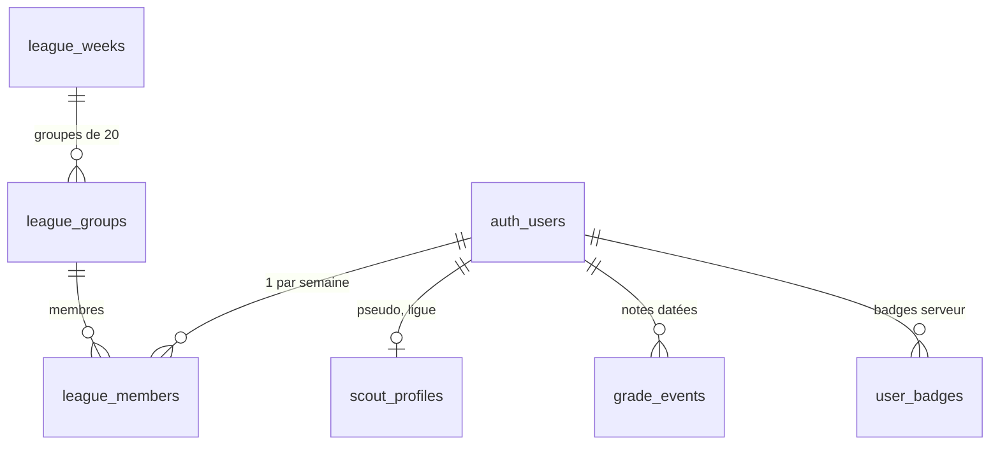

# Lot 5 : architecture back de la gamification (P3)

Rédigé par le back le 2026-10-14 à partir de `15-lot5.md` (G1-G5, P1-P7). Contrat d'API : `03-api-contract.md`, section « Lot 5 ».
Prototype validé sur la pile locale (PG 17.11, en transaction annulée) : `scratchpad/lot5-proto.sql` et `lot5-proto-test.sql`, à reprendre en P5. Ce n'est pas la migration finale.

## État P5 (2026-10-14) : ce qui remplace la suite de ce document

Les arbitrages A5 à A11 de `15-lot5.md` priment. Implémentation : `supabase/migrations/20261014120000_lot5_league.sql`, `20261014120100_lot5_pseudo.sql`, `20261014120200_lot5_cron.sql` ; tests `supabase/tests/05_lot5_league_test.sql`, `06_lot5_social_test.sql`. Contrat à jour : `03-api-contract.md`, L5.

| Sujet | P3 (ci-dessous) | P5 (fait foi) |
|---|---|---|
| XP de ligue (H1) | 10 forfaitaires par carte | A11 : QCM 10 si `a` = `qcm.ok` (vérifié serveur), sinon 0 ; carte sans `qcm` 5 fixes ; « J'interroge » rien. Colonne `grade_events.xp` (0, 5, 10) ; la note d'un QCM est celle du serveur. |
| Plafond (H2) | 40 cartes/jour | A6 : 30 cartes/jour, QCM ratés compris |
| Semaine (H3) | lundi-dimanche 23:59, grâce 6 h | A7 : lundi 00:00 à dimanche 20:00 UTC ; `league_week_of(t) = date_trunc('week', t + 4 h)`. Notes acceptées jusqu'au lundi 06:00. Colonne `grade_events.week_start` ; champ `t` (epoch) facultatif dans `p_grades`. |
| Montée/descente (§4) | min(5, n/4) | A8 : montent les min(5, ⌊n/3⌋) premiers ayant ≥ 50 XP ; descendent les min(3, ⌊n/5⌋) derniers sauf ≥ 100 XP ; ligue 6 sans montée, ligue 1 sans descente. |
| Défi (§6) | 4 variantes de jours/cartes | A9 : rotation C4 (`active_days` 4, `zone_cards` 30, `su` 40, `cards` 60), semaine du 2026-10-12 = rang 0. |
| Pseudo (§6) | `_ . -` | C5 : `-` et `_` seulement, commence par une lettre, 4 chiffres au plus, lettres wolof `ë ñ ŋ` ; mots exacts comparés aussi sans chiffres. |
| Signalement | proposé | A4 : `pseudo_reports`, admin `ignore` en plus de `reset` et `refuse`. |
| Mots refusés | liste du PM | A10 : amorcée en migration (FR + wolof), éditable par 3 RPC admin. |
| Opt-out | garde le pseudo | `set_league_opt_in(false)` libère le pseudo (design P-G) ; `set_pseudo` rétablit l'opt-in. |
| Groupes | 21 membres possibles | verrou consultatif par (semaine, ligue) : jamais plus de 20. |
| Badges serveur | `promoted`, `podium`, `challenge` | plus `polar_star` ; `promoted` et `polar_star` une seule fois. Podium : groupe d'au moins 5 classés, toutes ligues (C6). |

## 0. Hypothèses (à confirmer par le PM, voir §10)

- H1 : XP de ligue **forfaitaire** : 10 points par carte notée, quelle que soit la note (Raté, Hésitant, Su). La note est auto-déclarée : la payer davantage pousserait à cliquer « Su », ce qui dégraderait le garde-fou « part de Su ».
- H2 : plafond **40 cartes comptées par jour** (400 XP/jour, 2 800 XP/semaine au plus).
- H3 : délai de grâce **6 h** : la semaine du lundi au dimanche (UTC, heure de Dakar) accepte des notes jusqu'au lundi 06:00 UTC.
- H4 : **6 ligues** (noms par le design), groupes de 20 au plus, 5 montent et 5 descendent dans un groupe de 20.
- H5 : défi de la semaine **individuel** (même objectif pour tous), tiré d'une rotation fixe. Pas d'objectif collectif.
- H6 : `pg_cron` est présent dans l'image locale (1.6.4) ; Supabase le propose sur tous les plans (« Supabase Cron »). À confirmer par le SRE dans le tableau de bord. La clôture paresseuse reste en place dans tous les cas.

## 1. Principe anti-triche (P1)

L'XP de ligue est **dérivée de faits** : des événements de notation `(user, jour, carte)` insérés par le serveur, au plus un par carte et par jour. Elle n'est jamais déclarée par le client.

- `progress.xp` et `p_xp` **restent** : XP personnelle (niveaux G4, affichage hors ligne). Aucune fonction de ligue ne les lit. Test pgTAP : `p_xp = 10 000 000` ne change rien au classement.
- `save_progress` reçoit un 4e paramètre `p_grades` (liste des notes faites depuis le dernier envoi). Chaque note est filtrée côté serveur :

| Filtre | Effet contre la triche |
|---|---|
| Clé primaire `(user_id, day, card_id)` | Rejouer, renvoyer, ou noter 50 fois la même carte = 1 seul point. |
| Carte existante et `status = 'published'` | Pas d'identifiant inventé. |
| `day` entre `max(aujourd'hui - 8, jour d'inscription)` et `aujourd'hui + 1` (UTC serveur) | Pas de note dans le futur, ni avant l'inscription. `+1` tolère les fuseaux à l'est. |
| Semaine de `day` encore ouverte : `now() < lundi suivant 00:00 + 6 h` | Pas de rattrapage d'une semaine passée. |
| Plafond 40 cartes par `(user, day)` | Un script ne dépasse pas le plafond d'un scout assidu. |
| `user_id = auth.uid()` seul, sérialisé par le verrou de la ligne `progress` | Pas de score pour autrui ; deux appareils ne doublent pas le plafond. |

**Ce que peut encore un tricheur** : atteindre le plafond honnête (2 800 XP/semaine) avec un script, y compris en antidatant des notes dans la semaine en cours. Accepté : borne connue, égale à ce qu'atteint un scout très assidu. Départage à égalité : premier arrivé au score (`last_gain_at`). Si cela devient un problème : baisser le plafond, ou exiger que la carte soit due ou nouvelle selon `progress.cards` (rejeté pour l'instant : `progress.cards` est lui aussi déclaré par le client).

## 2. Modèle de données

| Table | Colonnes clés | Contraintes |
|---|---|---|
| `scout_profiles` | `user_id` PK, `pseudo`, `pseudo_key` UNIQUE, `pseudo_state` (`none`/`ok`/`reset`), `pseudo_changed_at`, `league_opt_in` (défaut vrai), `tier` 1..6, `tier_from` date | regex du pseudo, `(pseudo is null) = (pseudo_key is null)` |
| `pseudo_blocklist` | `word` PK (`^[a-z0-9]{3,30}$`), `exact` booléen | amorcée par migration, complétée par l'action « refuser » |
| `grade_events` | PK `(user_id, day, card_id)`, `grade` 0..2, `received_at` | `day` en jours depuis 1970 (même unité que `dayNum`) |
| `league_weeks` | `week_start` PK (lundi), `closed_at` | `isodow = 1` |
| `league_groups` | `id` identity, `week_start`, `tier` | index `(week_start, tier)` |
| `league_members` | PK `(week_start, user_id)`, `group_id`, `tier`, `public_id` uuid aléatoire UNIQUE, `xp`, `last_gain_at`, `joined_at`, `final_rank`, `outcome` -1..1 | index `(group_id)` |
| `user_badges` | PK `(user_id, badge, week_start)`, `earned_at` | badges serveur seulement (§6) |

- `league_members.xp` est un cache : il vaut `10 × count(grade_events)` de la semaine, recalculable, ce que vérifie un test.
- `public_id` est l'identifiant exposé aux autres scouts (signalement, clé de liste React). Il change chaque semaine et ne permet pas de remonter à `user_id`.
- Rétention : la clôture supprime les `grade_events` de plus de 8 semaines (mesure du garde-fou sur 4 semaines avant/après).
- Suppression de compte : `on delete cascade` partout depuis `auth.users`.

## 3. Écriture : `save_progress(p_cards, p_sessions, p_xp, p_grades default '[]')`

- Même fusion qu'au lot 2 (inchangée), puis ingestion des notes **dans la même transaction**, après le verrou de la ligne `progress`.
- `p_grades` : tableau de 500 objets `{c, d, g}` au plus, sinon `22023`. Une note invalide (carte inconnue, jour hors borne, semaine close, plafond atteint, doublon) est **ignorée sans erreur** : un seul mauvais élément ne doit pas bloquer l'envoi de toute la progression (le front classe `22023` en refus définitif).
- Retour : les 4 colonnes actuelles plus `week_xp` (XP de ligue de la semaine en cours) et `grades_counted`. Le front supprime de sa file **toutes** les notes envoyées dès que l'appel réussit (comptées, doublons ou trop tardives, le résultat ne changera plus).
- Si la note fait gagner des points et que le scout est éligible (pseudo `ok`, `league_opt_in`), il entre dans un groupe (§5).
- Implémentation P5 : pas de table temporaire dans la fonction (prototype seulement) ; un CTE sur `jsonb_to_recordset`.

**Hors ligne (P4).** Le front garde une file locale `xxb.grades.v1.<user_id>` : `[{c, d, g}]`, une entrée par `(c, d)` (la première note du jour), `d = dayNum(date de la note)`, purge des entrées `d < aujourd'hui - 8`. Une note faite dimanche hors ligne et envoyée lundi avant 06:00 UTC compte pour la semaine passée ; après, elle ne compte que pour l'XP perso. Le renvoi de la même file est sans effet (clé primaire).

## 4. Clôture hebdomadaire (P5)

`league_close_week(p_week, p_now)` (interne, non exécutable par les clients) :
1. Rien si `p_now < week_deadline(p_week)` (lundi suivant 06:00 UTC).
2. Verrou `select ... for update` sur `league_weeks` ; rien si `closed_at` est déjà posé. **Rejouer = sans effet.**
3. Rang par groupe : `xp desc, last_gain_at, joined_at, user_id` (déterministe).
4. Issue : `k = min(5, n / 4)` montent et descendent (`n` membres du groupe) ; groupe de 2 ou 3 : le premier monte, personne ne descend ; seul dans son groupe : rien. Pas de montée en ligue 6, pas de descente en ligue 1.
5. `scout_profiles.tier := member.tier + outcome` et `tier_from := p_week + 7` : **affectation, jamais incrément**, donc pas de double promotion même en rejouant à la main.
6. Badges `promoted` et `podium` (`on conflict do nothing`), `closed_at = p_now`, purge de rétention, puis entrée en groupe des scouts déjà actifs dans la nouvelle semaine (§5).

Données figées : les notes d'une semaine sont refusées après sa date limite, quelle que soit l'heure de passage du cron. La clôture lit donc toujours les mêmes données et donne le même résultat.

Déclenchement : `league_close_due(now())` ferme toutes les semaines échues non closes.
- `pg_cron` : `cron.schedule('xxb-close-weeks', '5 * * * *', 'select public.league_close_due()')` (toutes les heures).
- Clôture paresseuse : `get_league_state` appelle aussi `league_close_due()` (une lecture d'index partiel `where closed_at is null` quand il n'y a rien à faire). Le cron n'est donc qu'une accélération.

Le prototype a vérifié : plafond à 40, renvoi = 0 point, note de dimanche acceptée à 05:00 et refusée à 07:00 le lundi, clôture à 05:59 refusée, à 06:05 faite, rejouée deux fois sans effet, 5 montées dans un groupe de 20, 1 dans un groupe de 4.

## 5. Groupes et cas limites

- **Entrée paresseuse** (comme Duolingo) : un scout entre dans un groupe à sa première note comptée de la semaine. Pas de membre fantôme à 0 XP.
- Groupe choisi : le groupe ouvert le plus rempli (< 20) de sa ligue, sinon un nouveau. Les groupes se remplissent dans l'ordre d'arrivée. Deux arrivées simultanées peuvent donner 21 membres : toléré.
- **Nouveau scout en cours de semaine** : ligue 1, entre à sa première note, avec l'XP déjà gagnée cette semaine (recalculée depuis `grade_events`).
- **Pseudo choisi en cours de semaine** : même chose, l'XP de la semaine est reprise.
- **Lundi entre 00:00 et 06:00** : la semaine passée n'est pas close, la ligue de la nouvelle semaine n'est pas connue. Les points s'accumulent dans `grade_events`, l'entrée en groupe est faite par la clôture (étape 6) ou au prochain envoi. `get_league_state` renvoie `status: "pending"`.
- **Scout inactif** une semaine : absent des groupes, ni montée ni descente, il garde sa ligue.
- **Petit groupe** : règle du §4. Les petits groupes ne sont pas fusionnés (simplicité ; volume faible en début de lot).
- **Opt-out** (`set_league_opt_in(false)`) : sa ligne de la semaine en cours est supprimée, il disparaît du classement tout de suite ; ses `grade_events` restent (XP de ligue retrouvée s'il revient dans la semaine).
- **Pseudo réinitialisé par l'admin** : le scout reste membre, mais il n'est plus affiché aux autres et il n'est plus classé jusqu'à un nouveau pseudo (filtre `pseudo_state = 'ok'` à la lecture et à la clôture).

## 6. Pseudo, badges, niveaux, défi

**Pseudo (G2, P3).**
- Format : 3 à 20 caractères parmi les lettres latines (accents compris), les chiffres et `_ . -`. Regex en base et dans le RPC.
- `pseudo_key` = minuscules, sans accent (`translate`, fonction immutable, sans extension), sans séparateur : `Élodie_K` = `elodiek` = `ELODIE.K`. Unicité par index UNIQUE.
- Mots refusés : `pseudo_key` (et sa forme avec `0→o 1→i 3→e 4→a 5→s`) ne contient aucun mot de `pseudo_blocklist` (`exact = false`) et n'en égale aucun (`exact = true`). Le PM et le design fournissent la liste (français, wolof).
- Changement de pseudo : une fois par 24 h au plus, sauf après une réinitialisation par l'admin.
- Admin (`is_admin()` existant) : `admin_list_pseudos` (recherche et pagination) et `admin_moderate_pseudo(user, 'reset' | 'refuse')`. `refuse` réinitialise et ajoute la clé à la liste (`exact = true`). Le scout voit `pseudo_state = 'reset'` et un message.

**Badges (G3).** Arbitrage :
- **Côté client, hors ligne** : badges personnels dérivés de `progress` (série de jours, questions sues, thème maîtrisé). Ce sont des fonctions pures dans `srs.ts`, sans stockage, aussi trichables que l'XP perso, ce qui est sans enjeu pour les autres.
- **Côté serveur** (`user_badges`) : ceux qui touchent au classement ou au défi (`promoted`, `podium`, `challenge`). Ils sont renvoyés par `get_league_state` et mis en cache local pour l'affichage hors ligne.

**Niveaux (G4).** Côté client, depuis `progress.xp` (`xpLevel`, `RANKS` existants ; noms par le design). Aucun changement serveur.

**Défi (G5).**
- `league_challenge(week)` est une fonction immutable qui tourne sur une liste fixe : `active_days ≥ 4`, `cards ≥ 120`, `active_days ≥ 5`, `cards ≥ 150`.
- La progression est calculée depuis `grade_events` (donc vérifiable). Le badge `challenge` est attribué dans `save_progress` dès que l'objectif est atteint.
- Le défi est ouvert à tous, avec ou sans pseudo.

## 7. Lecture du classement

`get_league_state()` (security definer, `authenticated`) renvoie un seul JSON (contrat §L5-3) : statut, ligue, groupe (≤ 20 lignes de `public_id, pseudo, xp, rank, zone, is_me`), dernier résultat, défi, badges serveur.
- **Jamais** de `user_id` d'autrui, d'e-mail, de nom, de progression ni de `tier_from`. Test pgTAP : le texte JSON ne contient ni `@` ni aucun `user_id` des autres membres.
- Toutes les nouvelles tables : RLS activée **sans aucune politique** pour `anon` et `authenticated`, plus `revoke all ... from anon, authenticated`. Seuls les RPC `security definer` y accèdent.
- Constaté en local : `pg_default_acl` de `postgres` accorde encore `arwd` sur les tables et **`EXECUTE` sur les fonctions** à `anon` et `authenticated`. Chaque fonction interne (`league_*`, `pseudo_key`, `week_*`) doit donc recevoir `revoke all ... from public, anon, authenticated` ; les RPC publics, `grant execute ... to authenticated` seulement. Un test pgTAP vérifie la liste des fonctions exécutables par `anon`.

## 8. Coût (plan gratuit, ~500 scouts)

- Écritures : aucune requête de plus, les notes partent avec `save_progress`. Au pire 500 × 40 = 20 000 lignes/jour ; réaliste 300 × 25 = 7 500.
- Stockage : environ 100 octets par ligne avec l'index, 8 semaines ≈ 420 000 lignes ≈ 45 Mo au pire réaliste. `league_members` : environ 500 lignes/semaine.
- Egress : `get_league_state` ≈ 3 Ko ; 500 scouts × 5 ouvertures/jour ≈ 7,5 Mo/jour ≈ 225 Mo/mois, sous les 5 Go. Le classement n'est chargé qu'à l'ouverture de l'écran Ligue (P7), pas de Realtime.
- Index : PK `grade_events (user_id, day, card_id)` (plafond, doublons, défi) ; `league_members (group_id)` ; `league_groups (week_start, tier)` ; partiel `league_weeks (week_start) where closed_at is null`. Plafond de 500 notes par appel.

## 9. Compatibilité et déploiement (base avant front)

- `drop function save_progress(jsonb, jsonb, integer)` puis création de la version à 4 paramètres, `p_grades` ayant un défaut. Il faut supprimer l'ancienne : avec deux surcharges, PostgREST ne saurait pas choisir pour un appel à 3 clés. Le front du lot 4 continue d'appeler avec 3 clés ; la colonne `week_xp` en plus est ignorée par `parseStoredProgress`. Remettre `grant execute` après le `create`.
- Le front du lot 4 n'envoie pas de notes : ses utilisateurs ne marquent pas de points de ligue tant que leur PWA n'est pas à jour. C'est sans conséquence, puisque les ligues n'existent que dans le front du lot 5.
- Entre le `drop` et le rechargement du cache PostgREST, un appel peut échouer : le front le classe en `retry`, rien n'est perdu.
- Retour arrière : recréer la version à 3 paramètres du lot 2. Les nouvelles tables peuvent rester (inertes).
- `create extension if not exists pg_cron` et `cron.schedule` dans une migration séparée, que le SRE peut sauter si le cron est refusé.

## 10. ADR courts

**ADR-2 : l'XP de ligue vient d'événements serveur, pas de `progress.xp`.** Acceptée sous réserve de H1 et H2.
- Alternatives écartées : différence de `progress.cards` d'un envoi à l'autre (le nombre de vues est déclaré par le client, et le jour de la note est inconnu) ; RPC séparé `record_grades` (une requête de plus en 3G et pas d'atomicité avec la progression).
- À revoir si un mode QCM vérifié côté serveur apparaît : il permettrait de payer la réussite.

**ADR-3 : clôture par date limite fixe, cron plus repli paresseux.** La date limite (lundi 06:00 UTC) gèle les données, ce qui rend la clôture déterministe et rejouable.
- Alternatives écartées : cron seul (peut manquer une heure) ; paresseux seul (première lecture du lundi plus lente, sans gravité, il reste le repli).
- À revoir si les plaintes « ma note de dimanche n'a pas compté » apparaissent : allonger la grâce.

**ADR-4 : entrée paresseuse dans les groupes.** Pas de groupe formé à l'avance, donc pas de membres inactifs affichés.
- Coût : les groupes se remplissent par ordre d'arrivée et le dernier groupe d'une ligue peut être petit.
- À revoir au-delà de 2 000 scouts par ligue.

## 11. Plan de tests pgTAP (P5, fichier `05_lot5_test.sql`)

1. Anti-triche : `p_xp = 10 000 000` laisse `week_xp` inchangé ; 100 notes le même jour donnent 400 XP ; carte inconnue ou brouillon, jour futur (+2), jour antérieur à l'inscription : 0 point.
2. Idempotence : renvoyer la même file donne 0 point de plus ; deux notes de la même carte le même jour donnent 10 XP ; deux appareils en parallèle restent sous le plafond.
3. Hors ligne : note de dimanche reçue lundi 05:59 comptée, 06:01 refusée ; `league_members.xp = 10 × count(grade_events)`.
4. Clôture : refusée avant la date limite ; faite après ; rejouée 3 fois, `tier` et badges identiques (pas de double promotion) ; groupes de 20, 4, 3, 1 ; pas de montée en ligue 6 ni de descente en ligue 1 ; inactif inchangé.
5. Lundi matin : point avant clôture, pas de groupe ; groupe créé par la clôture avec la bonne ligue (montée appliquée).
6. Pseudo : longueur 2 et 21 refusées, caractères interdits, collision `Élodie`/`elodie`/`e.lodie`, mot refusé et variante `0→o`, changement dans les 24 h refusé, `refuse` admin puis réutilisation refusée, non-admin refusé sur les RPC admin.
7. Fuite : `get_league_state` ne contient aucun `@`, aucun `user_id` d'autrui ; scout sans pseudo ou opt-out absent des listes des autres ; pseudo réinitialisé masqué.
8. Droits : `anon` n'exécute aucun RPC du lot 5 ; `authenticated` n'exécute aucune fonction `league_*` interne ; aucun `select` direct sur les nouvelles tables ; RLS active partout.
9. Compatibilité : `save_progress` à 3 arguments nommés fonctionne et renvoie la même fusion que le lot 2 (tests 02 et 03 verts sans modification).

Pour les tests, les fonctions internes prennent `p_now` en paramètre (voyage dans le temps) ; les RPC publics passent `now()`.
